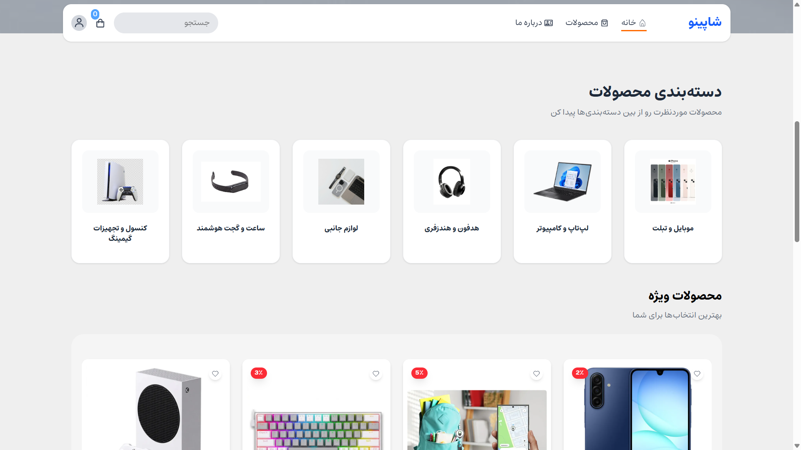
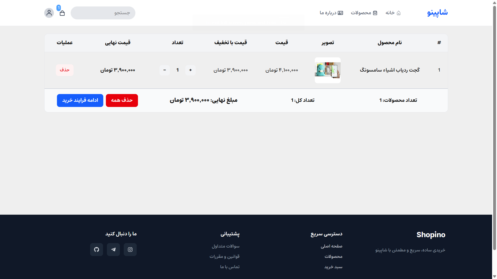
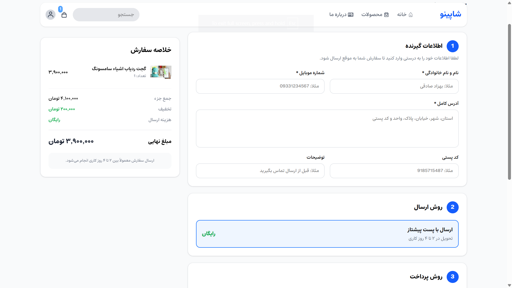

# Shopino | E-Commerce Store

Shopino is a **modern, responsive e-commerce application** built with React 19 and Tailwind CSS 4, powered by a **Strapi** backend. The user interface is fully localized in Persian with right-to-left (RTL) support, providing a shopping experience that covers product browsing, search, cart management, and user authentication.

## Screenshots:






## Features

- **Home Page:** Discounted product slider powered by Swiper, featured products, and product categories.
- **Product Listing:** Browse all products or filter by category using query strings, with loading skeletons.
- **Live Search:** Search products by title directly from the navigation bar.
- **Product Details:** Image gallery, pricing, discount percentage, and stock availability.
- **Shopping Cart:** Add, remove, and update product quantities, with stock-based quantity limits.
- **Authentication:** User registration, login, forgot password, and password reset.
- **Protected Routes:** Checkout and profile pages are accessible only to authenticated users.
- **User Profile:** A dedicated page for user account information.
- **Checkout Page:** A checkout interface for the shopping process.
- **Responsive Design:** Mobile-friendly layouts with RTL support and the Estedad font.

## Tech Stack

| Category | Technology |
| --- | --- |
| Frontend | React 19 |
| Build Tool | Vite 8 |
| Styling | Tailwind CSS 4 |
| Routing | React Router 7 |
| State Management | Zustand with persist middleware |
| Slider | Swiper |
| Notifications | react-hot-toast |
| Icons | react-icons |
| Backend | Strapi REST API |
| Linting | ESLint 10 |

## Project Structure

```text
src/
├── assets/              # Images and Estedad font
├── Components/          # Navbar, Footer, ProductCard, Skeletons
├── Hooks/               # Custom hooks (useFormFields)
├── Layout/              # Main layout and Protected route
├── Pages/
│   ├── Home/            # Hero, Categories, Featured and Discount Products
│   ├── Products/
│   ├── ProductDetails/
│   ├── Cart/
│   ├── Checkout/
│   ├── Auth/            # Login, Register, Forgot and Reset Password
│   ├── Profile/
│   └── About/
├── Routes/              # Routing configuration
├── Store/               # Zustand stores (auth, cart)
└── Utils/               # API layer (fetchData) and notifications
```

## Architecture Highlights

- **Centralized API Layer:** The `fetchData` utility reads the base URL from environment variables and handles API responses consistently. On a `401 Unauthorized` response, the user is automatically logged out.
- **Lightweight State Management:** Zustand manages authentication and shopping cart state. Authentication data is persisted in `localStorage`.
- **Stock Management:** Product quantities in the cart cannot exceed available inventory.
- **Protected Routes:** The `checkout` and `profile` pages are wrapped in a `Protected` component.

## Getting Started

### Prerequisites

- Node.js 20 or later
- npm
- A running Strapi backend (see [Backend Configuration](#backend-configuration))

### Installation

```bash
git clone https://github.com/iBehzadi/Shopino.git
cd Shopino
npm install
```

### Environment Variables

Create a `.env` file in the project root:

```env
VITE_BASE_URL=http://localhost:1337/api/
VITE_BASE_FILE=http://localhost:1337
```

| Variable | Description |
| --- | --- |
| `VITE_BASE_URL` | Base URL for the Strapi REST API. Should end with `/`. |
| `VITE_BASE_FILE` | Base URL of the server used to serve uploaded images. |

### Running the Project

```bash
npm run dev       # Start the development server
npm run build     # Build for production
npm run preview   # Preview the production build
npm run lint      # Run ESLint
```

## Backend Configuration

Shopino uses a **Strapi v5** backend. The frontend interacts with the following API endpoints:

- `products` — Product data, including populated relations, category filtering, and title search.
- `categories` — Product categories.
- `auth/local` — User login.
- `auth/local/register` — User registration.
- `auth/forgot-password` — Password recovery.
- `auth/reset-password` — Password reset.

Products require fields such as `title`, `price`, `discountPrice`, `stock`, `images`, and `categories` (including the category `slug`).

Make sure the backend is running and the required API permissions are configured before starting the frontend.

## Project Status & Roadmap

The checkout page currently provides the user interface only. Order creation and payment gateway integration have not yet been implemented.

- [ ] Implement order creation in Strapi and integrate a payment gateway.
- [ ] Persist shopping cart data in `localStorage` or on the server.
- [ ] Send JWT tokens in the headers of authenticated API requests.
- [ ] Add order history to the user profile.
- [ ] Implement product pagination.
- [ ] Add automated tests and CI using GitHub Actions.

## Developer

**Behzad Sadeghi**

- [GitHub](https://github.com/iBehzadi)
- [Linkedin](https://www.linkedin.com/in/ibehzadi)

## License

This project is licensed under the [MIT License](./LICENSE).
